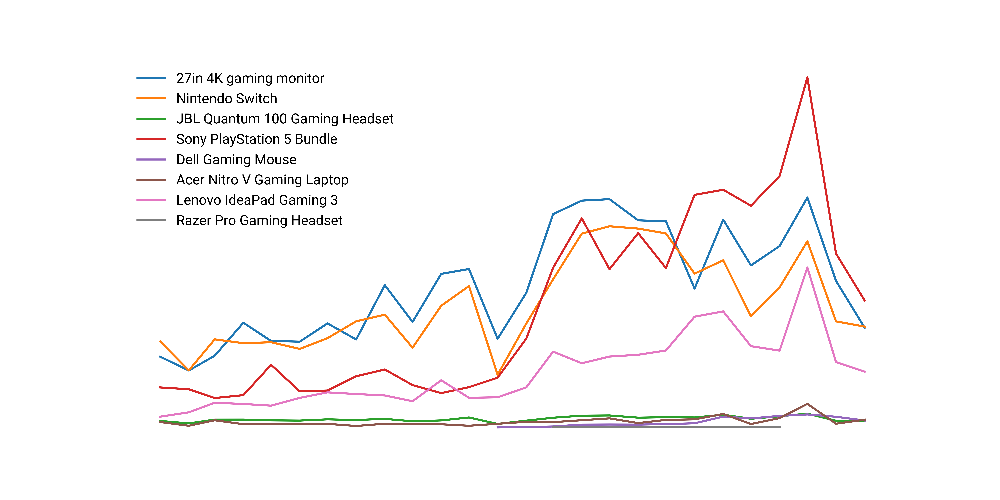
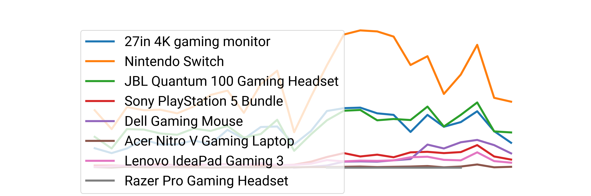

<p align="center">
  
</p>

# <p align="center">Client Background</p>

[The Game Zone](https://gamezonenj.com/) is an international video game store specializing in new and pre-owned games, systems, and accessories from ALL generations throught the history of gaming. Apart from generation systems such as retro games and consoles that includes hard-to-find titles, The Game Zone also showcases a massive collection of modern-day computer electronics.

The Game Zone's book of business in online consumer electronics is approaching 30,000 customers and possesses over 50,000 transactions, generating gross revenue of near $5 million. The available eCommerce data spans various dimensions and metrics, including sales, products, and marketing channels.

Reporting to the head of Sales and Operations, an in-depth analysis was conducted to evaluate The Game Zone's perfomance from 2019 to early 2021. This comprehensize review provides valuable insights that internal cross-functional teams will utilize to streamline process and enhance The Game Zone's commercial performance. The key insights and recommendations focus on the following areas:


## Northstar Metrics
- [Sales trends](#sales_trends): focusing on key metrics of sales revenue, number of orders placed, and average order value
- [Product performance](#product_performance): analyzing different product lines, market impact, and refund rates to inform strategic product decisions
- [Marketing channels](#marketing_channel): investigating the main driver of revenue through different channels
- [Customer acquisition](#customer_acquisition):
#

<table align="center">
  <tr>
    <div width="920">
      <h1 align="center">Executive Summary</h1>
      <div align="center">
        
      </div>
      <td width="460" valign="top">
        <ol>
          <li>
            <strong>Revenue Growth and Peak Performance:</strong>
            <ul>
              <li>2020 was the strongest year, with sales growing each quarter as a result of the higher order frequency.</li>
              <li>Q4 2020 saw the highest revenue $410k in December 2020, making it the best-performing month.</li>
              <li>April 2020 ($300k) and September 2020 ($320k) also maintained strong sales, though a minor downward trend started afterward.</li>
            </ul>
          </li>
          <li>
            <strong>Declining Trend in Q1 2020</strong>
            <ul>
              <li> A significant downward trend occurred in January 2020 ($94k), the operational pause at first two-thirds of the month led to extreme lack of completed transactions.</li>
              <li>The Q1 revenue decline suggests a major downturn caused internal operational shifts.</li>
            </ul>
          </li>
        </ol>
      </td>
      <td width="460" valign="top">
        <ol start="3">
          <li>
            <strong>Quarterly Insights & Seasonal Trends</strong>
            <ul>
              <li>Q3 and Q4 of each year typically show strong performance, likely due to seasonal shopping trends and marketing efforts.</li>
              <li>Revenue quickly dropped every Q1, signaling an overall weak performance compared to the other quarters.</li>
            </ul>
          </li>
          <li>
            <strong>Key Takeaways & Recommendations</strong>
            <ul>
              <li>Investigate the causes of the January 2020 which causes the decline (e.g., market changes, competition, internal factors).</li>
              <li>Leverage high-performing periods (e.g., December 2020 and Septermber 2020) to refine marketing and sales strategies.</li>
              <li>Reassess business strategy for the upcoming year, focusing on promotions, pricing, and customer engagement to regain momentum.</li>
            </ul>
          </li>
        </ol>
      </td>
    </div>
  </tr>
</table>


## Dataset Structure and Entity Relationship Diagram(ERD)

dataset desc

row count ...

# <p align="center">Deep-dive Insights</p>
## Sales trends


<table>
  <tr>
    <td>
      <strong>Sales Revenue</strong>
      <ol>
        <li>Sharp Decline in Q4 2022 – A Major Sales Anomaly <ul>
            <li>Historically, Q4 (Oct-Dec) has been the strongest quarter due to holiday shopping (Black Friday, Cyber Monday, Christmas sales). However, in 2022, <strong>Q4 sales plummeted</strong>. </li>
            <li>December 2022 Sales Revenue was $262K (Previous years: $458K–$1.25M). This represents a <strong>~70-80% drop</strong> from Q4 2021 and an even sharper decline compared to Q4 2020. </li>
          </ul>
        </li>
        <li>Declining Growth Throughout 2022 – Indicating Weak Consumer Demand <ul>
            <li>Each quarter in 2022 experienced a downward trend.</li>
            <li>Q1: Started fairly strong ($704K in Jan) but lower than 2021.</li>
            <li>Q2 - Q3: Dropped further, below $500K per month and continued decline through Q3 with Aug/Sep below $400K.</li>
            <li>Q4: <strong>Historic low, indicating critical demand issues</strong>. This suggests customer retention, pricing, or product-market fit issues. TechSphere may need to re-strategize through marketing, promotions, or change in pricing. </li>
          </ul>
        </li>
      </ol>
      <strong>Average Order Value</strong>
      <ol>
        <li> Sharp AOV Surge in 2020, followed by a Decline in early 2021 <ul>
            <li>
              <strong>2020 saw the highest AOV growth, peaking at $322 (Oct 2020)</strong> compared to $246 (Nov 2019), aligning with pandemic-driven eCommerce boom.
            </li>
            <li>Post-pandemic correction (2021-2022) led to a steady decline, with AOV in 2022 returning close to 2019 levels (~$234-$237).</li>
          </ul>
        </li>
        <li>2022 AOV is lower and relatively more volatile compared to previous years <ul>
            <li>
              <strong>2022 AOV fluctuates significantly </strong> between $216 (Oct) and $256 (Sep).
            </li>
            <li>Q4 2022 AOV is significantly lower than Q4 2020 & 2021, meaning holiday spending per order has dropped.</li>
          </ul>
        </li>
        <li>Long-Term AOV Decline May Indicate Price Sensitivity <ul>
            <li>From a peak of ~$322 in 2020, AOV steadily dropped to ~$234 in 2022 which is 27% drop.</li>
            <li>Over the span of four years, the change in AOV growth has been relatively constant, indicating minimal changes in product pricing (as illustrated in Sales Growth vs. AOV Growth below).</li>
            <li>AOV in 2022 is likely not a major factor in the decline of sales that year.</li>
          </ul>
        </li>
      </ol>
      <strong>Order Count</strong>
      <ol>
        <li>Order counts closely follow sales revenue, indicating that the decline in revenue is primarily due to <strong>fewer orders</strong> rather than a drop in AOV in 2022. </li>
        <li>Total orders <strong>dropped by 38%</strong> from 2021 to 2022. </li>
        <li>The sales anamoly and decline <strong>started in mid-2022</strong>, with orders falling from 2,034 in July to just 825 in October. </li>
        <li>While people are spending slightly less per order, the <strong>decline in order frequency</strong> directly results in lower sales revenue. </li>
      </ol>
    </td>
  </tr>
</table>

[dashboard](https://app.powerbi.com/links/wZegzjhRym?ctid=e93c0c9e-286e-4c79-b4cd-be2a9d8ccf16&pbi_source=linkShare)

customer is spending more per transaction, but the total number of transactions per paying customer has dropped
### <p align="center">show fluctuations</p>


## Product performance




## 

## 


<details>
<summary><b>Table of Contents (Click to expand)</b></summary>

* [1. Introduction](#1-introduction)
* [2. Getting Started](#2-getting-started)
  * [2.1 Installation](#21-installation)
  * [2.2 Configuration](#22-configuration)
* [3. Advanced Usage](#3-advanced-usage)

</details>
## 1. Introduction
This is the introduction section.

## Frequently Asked Questions
This is the FAQ section.


<details>
  <summary>Click to expand</summary>
  #asdasdasdas
  Your Markdown content or text goes here.

</details>

## Entity Relationship Diagram


# <p align="center">Refunds</p>


# <p align="center">Recommendations</p>

# <p align="center">Appendix</p>

<details>
  <summary>Python Visualization</summary>

  # This is a Heading
  * Item one
  * Item two

  ```python
  asdasdasd
  ```

</details>