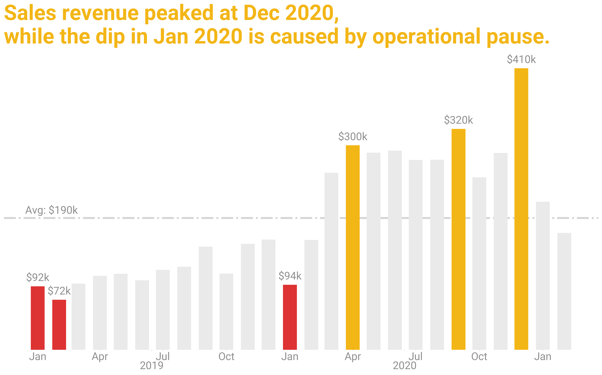
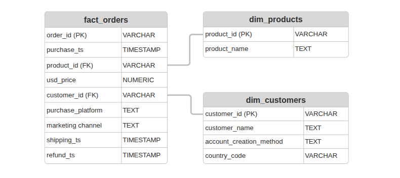
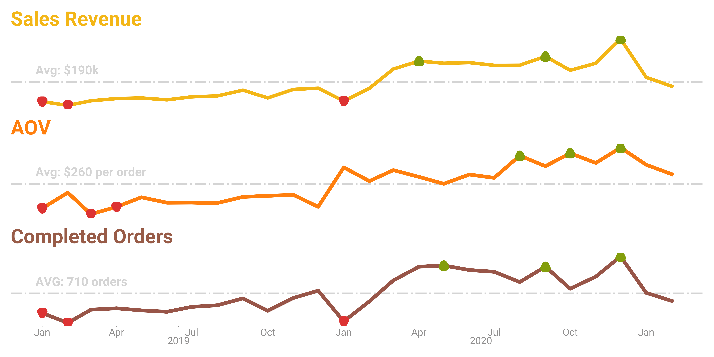
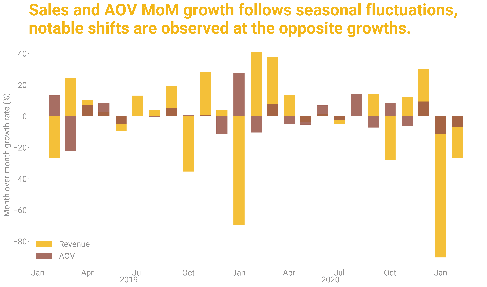
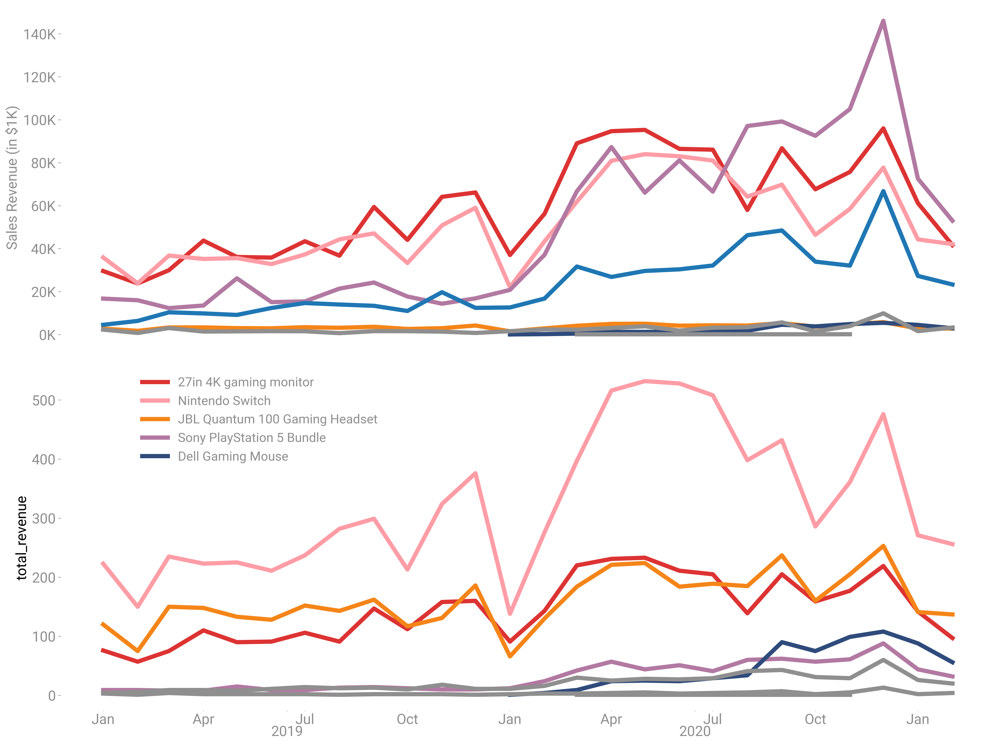
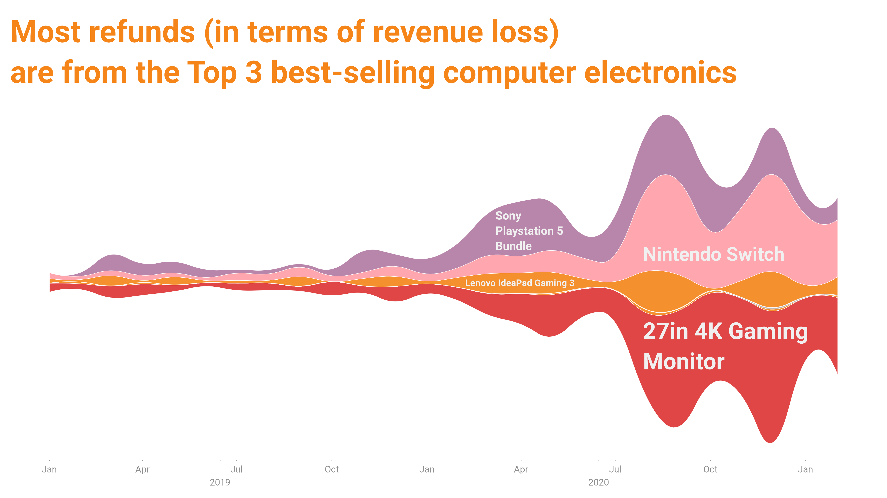
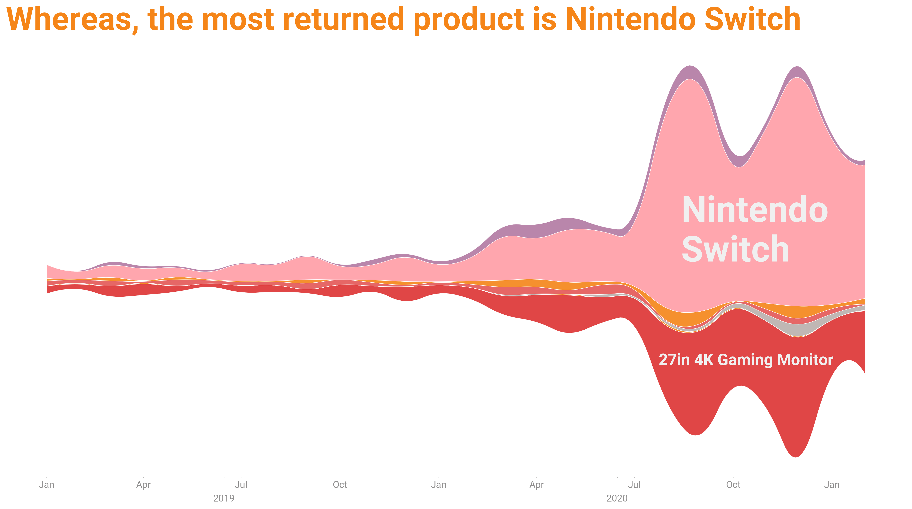

<p align="center">
  
</p>

# <p align="center">Client Background</p>

[The Game Zone](https://gamezonenj.com/) is an international video game store specializing in new and pre-owned games, systems, and accessories from ALL generations throught the history of gaming. Apart from generation systems such as retro games and consoles that includes hard-to-find titles, The Game Zone also showcases a massive collection of modern-day computer electronics.

The Game Zone's book of business in online consumer electronics is approaching 30,000 customers and possesses over 50,000 transactions, generating gross revenue of near $5 million. The available eCommerce data spans various dimensions and metrics, including sales, products, and marketing channels.

Reporting to the head of Sales and Operations, an in-depth analysis was conducted to evaluate The Game Zone's perfomance from 2019 to early 2021. This comprehensize review provides valuable insights that internal cross-functional teams will utilize to streamline process and enhance The Game Zone's commercial performance. The key insights and recommendations focus on the following areas:


## Northstar Metrics
- [Sales trends](#sales_trends): focusing on key metrics of sales revenue, number of orders placed, and average order value
- [Product performance](#product_performance): analyzing different product lines, market impact, and refund rates to inform strategic product decisions
- [Marketing channels](#marketing_channel): investigating the main driver of revenue through different channels
#

<table align="center">
  <tr>
    <div width="920">
      <h1 align="center">Executive Summary</h1>
      <div align="center">
        
      </div>
      <td width="460" valign="top">
        <ol>
          <li>
            <strong>Revenue Growth and Peak Performance:</strong>
            <ul>
              <li>2020 was the strongest year, with sales growing each quarter as a result of the higher order frequency.</li>
              <li>Q4 2020 saw the highest revenue $410k in December 2020, making it the best-performing month.</li>
              <li>April 2020 ($300k) and September 2020 ($320k) also maintained strong sales, though a minor downward trend started afterward.</li>
            </ul>
          </li>
          <li>
            <strong>Declining Trend in Q1 2020</strong>
            <ul>
              <li> A significant downward trend occurred in January 2020 ($94k), the operational pause at first two-thirds of the month led to extreme lack of completed transactions.</li>
              <li>The Q1 revenue decline suggests a major downturn caused internal operational shifts.</li>
            </ul>
          </li>
        </ol>
      </td>
      <td width="460" valign="top">
        <ol start="3">
          <li>
            <strong>Quarterly Insights & Seasonal Trends</strong>
            <ul>
              <li>Q3 and Q4 of each year typically show strong performance, likely due to seasonal shopping trends and marketing efforts.</li>
              <li>Revenue quickly dropped every Q1, signaling an overall weak performance compared to the other quarters.</li>
            </ul>
          </li>
          <li>
            <strong>Key Takeaways & Recommendations</strong>
            <ul>
              <li>Investigate the causes of the January 2020 which causes the decline (e.g., market changes, competition, internal factors).</li>
              <li>Leverage high-performing periods (e.g., December 2020 and Septermber 2020) to refine marketing and sales strategies.</li>
              <li>Reassess business strategy for the upcoming year, focusing on promotions, pricing, and customer engagement to regain momentum.</li>
            </ul>
          </li>
        </ol>
      </td>
    </div>
  </tr>
</table>

## Dataset Structure and Entity Relationship Diagram(ERD)

The database structure as seen below consists of four tables: orders, customers and products merged into a one big table (OBT) with a total row count of 21859 records. 

<div align = center>  </div>

#
# <p align="center">Deep-dive Insights</p>
# Sales trends

<table>
  <tr>
    <td>
      <strong>Sales Revenue</strong>
      <ol>
        <li>Sharp Decline in the October 2020 – Indicating a Sales Anomaly
          <ul>
            <li>Historically, Q4 (Oct-Dec) has been the strongest quarter due to holiday shopping (Black Friday, Cyber Monday, Christmas sales). However, there is a sales plummet in October 2020 sales due to the low number of completed orders. </li>
            <li>December 2020 Sales Revenue was $410K (Previous years: $160K). While this </li>
          </ul>
        </li>
        <li>Recurring Decline in October and January – Indicating Weak Consumer Demand
        <ul>
            <li></li>
        </ul>
        </li>
        <li>Growth Plateau in Q2 to early Q3
          <ul>
            <li></li>
          </ul>
        </li>
        <li>Peak Sales Revenue in 2019 is bought by higher demand on low end products
          <ul>
            <li>It is important to note that </li>
          </ul>
        </li>
      </ol>
      <strong>Average Order Value</strong>
      <ol>
        <li> Sharp AOV Surge in 2020, followed by a Decline in early 2021 <ul>
            <li>
              <strong>2020 saw the highest AOV growth, peaking at $335 per order (Dec 2020)</strong> compared to preceeding year's highest $243 per order (Feb 2019), indicating customers bought higher end products.
            </li>
          </ul>
        </li>
        <li>2022 AOV is lower and relatively more volatile compared to previous years <ul>
            <li>
              <strong>2022 AOV fluctuates significantly </strong> between $216 (Oct) and $256 (Sep).
            </li>
            <li>Q4 2022 AOV is significantly lower than Q4 2020 & 2021, meaning holiday spending per order has dropped.</li>
          </ul>
        </li>
        <li>Long-Term AOV Decline May Indicate Price Sensitivity <ul>
            <li>From a peak of ~$322 in 2020, AOV steadily dropped to ~$234 in 2022 which is 27% drop.</li>
            <li>Over the span of four years, the change in AOV growth has been relatively constant, indicating minimal changes in product pricing (as illustrated in Sales Growth vs. AOV Growth below).</li>
            <li>AOV in 2022 is likely not a major factor in the decline of sales that year.</li>
          </ul>
        </li>
      </ol>
      <strong>Order Count</strong>
      <ol>
        <li>Order counts closely follow sales revenue, indicating that the decline in revenue is primarily due to <strong>fewer orders</strong> rather than a drop in AOV in 2022. </li>
        <li>Total orders <strong>dropped by 38%</strong> from 2021 to 2022. </li>
        <li>The sales anamoly and decline <strong>started in mid-2022</strong>, with orders falling from 2,034 in July to just 825 in October. </li>
        <li>While people are spending slightly less per order, the <strong>decline in order frequency</strong> directly results in lower sales revenue. </li>
      </ol>
    </td>
  </tr>
</table>

[dashboard](https://app.powerbi.com/links/wZegzjhRym?ctid=e93c0c9e-286e-4c79-b4cd-be2a9d8ccf16&pbi_source=linkShare)

customer is spending more per transaction, but the total number of transactions per paying customer has dropped
### <p align="center">show fluctuations</p>



## Product performance



## 

## 


<details>
<summary><b>Table of Contents (Click to expand)</b></summary>

* [1. Introduction](#1-introduction)
* [2. Getting Started](#2-getting-started)
  * [2.1 Installation](#21-installation)
  * [2.2 Configuration](#22-configuration)
* [3. Advanced Usage](#3-advanced-usage)

</details>
## 1. Introduction
This is the introduction section.

## Frequently Asked Questions
This is the FAQ section.


<details>
  <summary>Click to expand</summary>
  #asdasdasdas
  Your Markdown content or text goes here.

</details>

## Entity Relationship Diagram


# <p align="center">Refunds</p>






<table align="center">
    <h1>Recommendations</h1>
    <h4>Based on the uncovered insights, here are actionable items that The Game Zone can take away from our analysis.</h4>
      <ul>
        <h3>Sales</h3>
        <li>Remedy sales dip due to seasonal fluctuations and operational pause.</li>
        <ul>
          <li>increase marketing campaigns during Q1.</li>
          <li>reduce downtime as it greatly affected sales</li>
        </ul>
        <li>Seek new customers</li>
          <ul><li>reason 1</li>
          <li>reason 2</li></ul>
        <h3>Products</h3>
        <li>Optimize inventory for high-performing products year-round.</li>
          <ul><li>The 27-Inch 4K Gaming Monitor is the strongest product in terms of sales, approaching (insert) over 2019 to early 2021.</li>
          <li>The (insert product) are also a strong-selling product, with close to (insert sales) in sales over (insert time).</li></ul>
        <li>Deprioritize inventory for low-performing products.</li>
          <ul><li>(insert products) for nearly 0% of total purchase orders.</li></ul>
        <li>Investigate sales for MacBook Air laptops.</li>
          <ul><li>MacBook Air Laptops rank third in sales revenue (22%) but fall in the bottom half for number of purchase orders (3.67%).</li></ul>
        <h3>Refund Rates</h3>
        <li>Streamline product quality control for for high AOV products as as they are the most frequently returned products.</li>
          <ul><li>Macbook Air Laptops had an average return rate of 14% from 2019 to 2021.</li>
          <li>Thinkpad Laptops also had an average return rate of 14% from 2019 to 2021.</li></ul>
        <h3>Marketing Channels</h3>
        <li>asdasd</li>
          <ul><li></li></ul>
</table>


<h1>Appendices</h1>
  <h4>Written below are the Python (Jupyter notebook) data cleaning, generating aggregations, and data visualization. If the tables already exist is within the database, the counterpart SQL queries were also written.</h4>
  
  <ul>
  <h3>Data Cleaning and Aggregation</h3>
  <details>
    <summary>Python</summary>

```python
import pandas as pd
import re
import numpy as np

df = pd.read_csv("../datasets/orders.csv").copy()

df.head(5)

# ====================================================================
# STEP 1: HEADER CLEANING
# ====================================================================
print(df.columns.tolist())
df.columns = df.columns.str.strip().str.lower().str.replace(" ", "_")
print("headers successfully cleaned")
print(df.columns.tolist())

# ====================================================================
# STEP 2: TYPE COVERSION & CURRENCY CLEANING
# ====================================================================
# columns: unit_price_usd, shipping_cost_usd

unit_price_usd_mask = df["usd_price"].astype(str).str.contains(r"\$")
print(df.loc[unit_price_usd_mask, ["order_id", "usd_price"]].head(3))

# ====================================================================
# STEP 3: DATE PARSING
# ====================================================================
# columns: purchase_ts, ship_ts

print(df["purchase_ts"].dtype)
print(df["ship_ts"].dtype)

df["purchase_ts"] = pd.to_datetime(df["purchase_ts"], format ="mixed", errors = "coerce")
df["ship_ts"] = pd.to_datetime(df["ship_ts"], format ="mixed", errors = "coerce")


# the nice to have--s
df["purchase_y"] = df["purchase_ts"].dt.to_period("Y")
df["purchase_ym"] = df["purchase_ts"].dt.to_period("M")
df["purchase_ymd"] = df["purchase_ts"].dt.to_period("D")
df["purchase_ymw"] = df["purchase_ts"].dt.to_period("W")
df["purchase_q"] = df["purchase_ts"].dt.to_period("Q")

# df = df.drop(columns=["purchase_year", "purchase_year_month", "purchase_year_month_week", "purchase_quarter"])

df["ship_y"] = df["ship_ts"].dt.to_period("Y")
df["ship_ym"] = df["ship_ts"].dt.to_period("M")
df["ship_ymd"] = df["ship_ts"].dt.to_period("D")
df["ship_ymw"] = df["ship_ts"].dt.to_period("W")
df["ship_q"] = df["ship_ts"].dt.to_period("Q")


df["purchase_platform"] = df["purchase_platform"].str.lower()
df["purchase_platform"].unique()

df["marketing_channel"] = df["marketing_channel"].str.lower()
df["marketing_channel"].unique()

df['marketing_channel'] = df['marketing_channel'].replace({np.nan: "organic", "uknown": "organic"})


df = df[~df["purchase_ts"].isna()]

df["account_creation_method"].unique()

df["product_name"].unique()

df["product_name"] = df["product_name"].replace("27inches 4k gaming monitor", "27in 4K gaming monitor")


# ====================================================================
# FINAL STEP: EXPORTING THE NEWLY CLEANED DATA
# ====================================================================
df.to_csv("../datasets/sales_data_cln.csv", index=False)
```
</details>


<details>
  <summary>SQL</summary>
  
  ```sql
-- combining all the necessary elements


-- create timestamp parser function; returns null if empty or unparsable
CREATE OR REPLACE FUNCTION try_to_timestamp(val TEXT)
RETURNS TIMESTAMP AS $$
BEGIN
    RETURN NULLIF(TRIM(val), '')::TIMESTAMP;
EXCEPTION WHEN OTHERS THEN
    RETURN NULL; 
END;
$$ LANGUAGE plpgsql IMMUTABLE;

-- create function to standardize currencies in usd; similar to prior function it returns null if empty or unparsable
CREATE OR REPLACE FUNCTION try_to_numeric(val TEXT)
RETURNS NUMERIC AS $$
BEGIN
    RETURN NULLIF(REGEXP_REPLACE(val, '[$,\s]', '', 'g'), '')::NUMERIC;
EXCEPTION WHEN OTHERS THEN
    RETURN NULL;
END;
$$ LANGUAGE plpgsql IMMUTABLE;


-- cleaning proper
DROP TABLE IF EXISTS sales_data_cln;
CREATE TABLE sales_data_cln AS
WITH parsed AS (
    SELECT
        order_id,
        try_to_numeric(usd_price)         AS usd_price,
        try_to_numeric(shipping_cost_usd) AS shipping_cost_usd,
        try_to_timestamp(purchase_ts)     AS purchase_ts,
        try_to_timestamp(ship_ts)         AS ship_ts,
        LOWER(purchase_platform)          AS purchase_platform,
        -- lower first, then fill NULL / typo -> 'organic' (same order as pandas)
        CASE
            WHEN marketing_channel IS NULL
              OR LOWER(marketing_channel) = 'uknown' THEN 'organic'
            ELSE LOWER(marketing_channel)
        END                               AS marketing_channel,
        account_creation_method,
        CASE
            WHEN product_name = '27inches 4k gaming monitor'
                THEN '27in 4K gaming monitor'
            ELSE product_name
        END                               AS product_name
    FROM stg_orders
)
SELECT
    *,
    DATE_TRUNC('year',    purchase_ts)::DATE AS purchase_y,
    DATE_TRUNC('month',   purchase_ts)::DATE AS purchase_ym,
    DATE_TRUNC('day',     purchase_ts)::DATE AS purchase_ymd,
    DATE_TRUNC('week',    purchase_ts)::DATE AS purchase_ymw,
    DATE_TRUNC('quarter', purchase_ts)::DATE AS purchase_q,
    DATE_TRUNC('year',    ship_ts)::DATE     AS ship_y,
    DATE_TRUNC('month',   ship_ts)::DATE     AS ship_ym,
    DATE_TRUNC('day',     ship_ts)::DATE     AS ship_ymd,
    DATE_TRUNC('week',    ship_ts)::DATE     AS ship_ymw,
    DATE_TRUNC('quarter', ship_ts)::DATE     AS ship_q
FROM parsed
WHERE purchase_ts IS NOT NULL;


-- sanity check; this query might be costly due to using distinct
SELECT DISTINCT purchase_platform      FROM sales_data_cln;
SELECT DISTINCT marketing_channel      FROM sales_data_cln;
SELECT DISTINCT account_creation_method FROM sales_data_cln;
SELECT DISTINCT product_name           FROM sales_data_cln;

-- hence, here are the CTE alternative for identifying unique entries per column

  ```
</details>


<h3>Executive Summary and Sales</h3>

<details> <summary>Python</summary>

</details>

<details> <summary>SQL</summary>

</details>

<h3>Product Performance</h3>

<details> <summary>Python</summary>

</details>

<details> <summary>SQL</summary>

</details>

<h3>Marketing Channel</h3>

<details> <summary>Python</summary>

</details>

<details> <summary>SQL</summary>

</details>